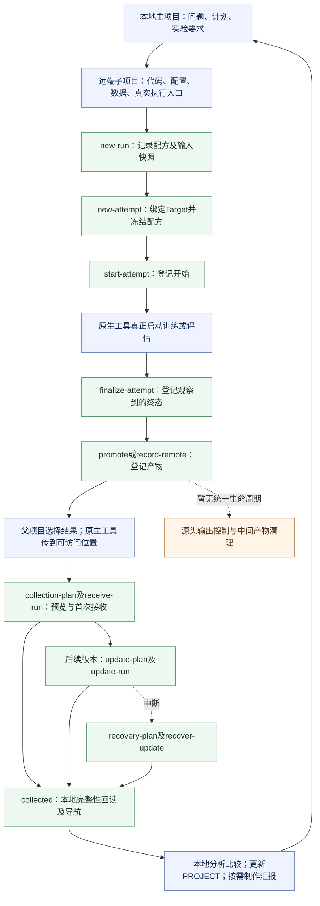
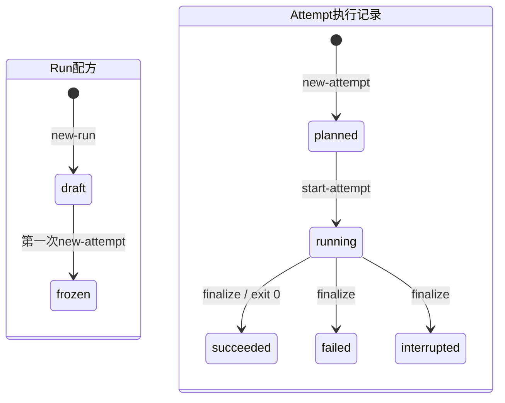

# 现有实验管理体系全景清点

核查日期：2026-11-14。范围：Scholar Workflow 0.55.2 的已安装接口、相关源码与运行契约。
核查方式：读取代码/契约、检查 CLI 帮助，核对25个项目管理模块及相关 Skill/reference 文件与已安装0.55.2内容一致。
本说明是现状清点，不是新设计或新生效规则。未运行实验、连接服务器、遍历真实研究项目或删除数据。
因此不能据此声称所有真实项目已经采用这些规范，也没有得出各服务器实际占用量。

## 1. 整体结构

当前体系由确定性档案程序、通用管理Skill、项目自己的执行脚本/Skill及外部工具共同组成。
CLI不托管训练进程，也不自动把下图所有步骤串起来。蓝色步骤主要依靠人/项目执行Skill/原生工具；绿色步骤已有确定性档案程序；虚线表示现有系统未闭环。



代码/记录与科学结论是两条不同的验证链：文件与声明一致，不自动证明执行确实发生；执行成功，也不自动证明结果有意义。

## 2. 角色和权威归属

| 对象 | 持有内容 | 不承担的职责 |
|---|---|---|
| 本地研究父项目 research-parent | PROJECT、唯一计划、知识/文献资料引用、agent指导、接收的实验档案、本地分析、最简代码恢复材料 | 不作为远端子项目的日常源码clone；不保存模型/权重作为本地结果 |
| 远端 execution-child | 独立源码Git、实际config/launcher/env、数据和实验执行、原始Run/Attempt与产物 | 不复制一套父项目总体知识、计划和PROJECT |
| Primary Subproject | 一种执行子项目角色；可按另行授权发布项目自有代码历史到GitHub | 不是父项目，也不是第三套执行架构 |
| Zotero/知识资产单元 | 论文及其附属内容的原有权威 | 不因项目引用而复制或改归属 |
| 原生工具和外部agent | SSH/Remote-SSH、cmux、实际调度与执行、授权范围内传输 | 注册Target或安装插件不会自动赋予访问权 |

父项目Git是本地管理Git；所有子项目代码变更在远端进行，各自有独立Git，只有primary按既定边界发布自有开发历史。
同一子项目跨服务器并行开发仍需分支/独立工作目录，执行使用固定commit，不在运行中更新工作树。
项目知识属于父项目的职责，但初始化不会自动建成一个独立的完整知识库或复制全部论文单元。

## 3. 初始化实际创建什么

### 本地父项目：初始化状态

```text
parent/
├── .git/                         本地管理Git
├── AGENTS.md                     根规则；CLAUDE.md、AGENT.md为引用入口
├── project-layout.json           schema 2，稳定project_id
├── project-management.json       schema 1，parent角色、children起初为空
├── project-context.json          空资料引用清单
├── PROJECT.md                    六节空入口，默认内联唯一计划
├── README.md                     对外说明空稿
├── .agents/skills/               空目录
├── assets/
├── docs/
│   ├── notes/
│   ├── plan/
│   └── report/
├── experiments/profiles/targets/
└── backups/code/                 本地代码恢复材料位置，不是开发clone
```

### 执行子项目：初始化状态

```text
child/
├── .git/                         独立源码Git
├── AGENTS.md                     CLAUDE.md、AGENT.md引用它
├── project-layout.json
├── project-management.json       parent UUID与primary声明
├── .agents/skills/               空目录
├── assets/
├── configs/components/           空；真实配置另行准备
├── configs/recipes/
├── env/
├── src/utils/dataset_toolkit/
├── tools/                        空；无通用自动launcher
├── tests/
├── dataset/                      按dataset聚合，不入源码Git
└── experiments/profiles/targets/  不入源码Git
```

选择源码profile才增加相应模块目录；例如paper-method的method/data/evaluation等仍只是目录，不是训练实现。
子项目不自动生成父项目的PROJECT、docs、project-context和backups。
初始化不会生成任务执行Skill、部署服务器、安装远端插件、创建SSH连接或填充实际config。
新父项目children为空，新子项目写有parent UUID；必须另行register-child，才有父端的子项目登记。
旧项目adopt-role只是显式补角色声明，不等于完成布局、Git、指导和档案迁移。

依据：[骨架契约](../../skills/init-project/references/skeleton-manifest.md)、[初始化程序](../../skills/init-project/scripts/init_project.py)。

## 4. 记录对象及实际文件

| 对象 | 描述什么 | 主要内容 |
|---|---|---|
| Run | 一组固定的科学配方 | child commit、入口/config/data manifest/env快照、dataset/version/split、seed、recipe hash |
| Attempt | 同一配方的一次执行或重试 | Target快照、状态、开始结束、exit code、调用者提供的actual信息、可选output inventory |
| Target | 计划执行位置与环境绑定 | local/ssh、server alias、project/output root、shell/slurm类型、环境绑定；无秘密 |
| Artifact | 一个登记产物 | role、所属Attempt、本地路径/大小/hash或远端位置、retention、未验证backup状态 |
| Collection receipt | 父项目实际收到的档案版本与映射 | parent/child/Run、证据摘要、文件映射、完整性信息、可选选择/省略记录 |
| 索引与人类视图 | 从已有权威记录派生的展示 | 不替代原始记录，不自动产生科学结论 |

一个Run的代码、配置、数据选择、seed或环境定义发生变化，应新建Run；同配方重试可新建Attempt。
Target和硬件位置不进入科学配方身份；机器变化不应被误当成新方法。

```text
child/experiments/<run-id>/
├── run.yaml
├── run.sh                        实际入口文件快照，不证明执行
├── inputs/
│   ├── resolved-config.<suffix>
│   ├── dataset-manifest.<suffix>
│   └── environment.<suffix>
├── report.md                     new-run自动建，初始只有标题
├── notes.md                      new-run自动建，初始只有标题
├── artifacts.yaml                初始为空
├── artifacts/                    promote的单文件复制目标
└── attempts/<attempt-id>/
    ├── attempt.yaml
    ├── target.yaml               执行时选定Target的快照
    └── output-inventory.<suffix>  仅finalize显式提供时存在
```

环境定义快照不证明实际机器环境一致；数据manifest不包含数据集本身；入口快照不包含完整仓库。
代码commit来自执行项目自己的Git HEAD，不应取父管理项目commit。当前clean检查针对已跟踪文件，未跟踪文件不参与clean判断。

## 5. 从准备到归档的每一步

这些步骤需要实际项目接口或显式CLI调用，不是一个已安装的自动流水线。

| 步骤 | 执行者/入口 | 实际输入和结果 | 现有边界 |
|---|---|---|---|
| 确定问题、对比与验收目标 | 人与项目agent，项目计划 | 目的、baseline/variant、数据范围及预期结果 | 没有通用科学方案生成程序 |
| 初始化与角色登记 | init-project；project register-child | UUID、角色、目录、父端child登记 | 不代表部署或远端可达 |
| 准备科学入口 | 项目config/launcher/执行Skill | 实际参数、环境、数据准备、训练/评测程序 | 初始化只给空目录，默认输出行为取决于真实项目 |
| 登记执行位置 | experiment target-add | 校验并登记Target YAML | 不登录服务器或检查GPU |
| 登记配方 | experiment new-run | 拷贝输入快照，创建draft Run及空档案 | 不执行脚本；同名拒绝 |
| 新建执行 | experiment new-attempt | 复制Target、创建planned Attempt、首次冻结Run | 不启动计算任务 |
| 登记开始 | experiment start-attempt | planned→running，写开始时间 | 不探测进程存活或提交Slurm |
| 真正执行 | 实际launcher、SSH/Slurm/外部工具 | 训练、评估、数据加工及磁盘输出 | 无通用监控、自动中断/恢复闭环 |
| 登记结束 | experiment finalize-attempt | 接受status、exit code、actual JSON，可选清单，写结束时间 | 观察由调用者提供；不自动采集或找结果 |
| 保存单个文件 | experiment promote | 复制一个可访问文件到Run/artifacts并记hash、大小、来源Attempt | 不等于回传完整Run；不是备份验证 |
| 只登记远端文件 | experiment record-remote | 记role/Attempt/remote source；本地size/hash/path为空 | 不验证远端文件存在、不下载 |
| 本地结构校验 | experiment validate | 检查快照、记录、路径、Target、产物一致性 | 不能验证指标意义、科学正确性或实际运行 |
| 建导航索引 | experiment index | 派生index.yaml：Run、状态、hash、Attempt状态 | 不包含完整指标比较与结论；父项目用collected |
| 子项目稳定结果可供收集 | 项目执行Skill/原生工具 | 固定版本、完整身份和必要结果 | 尚无通用远端选择导出器 |
| 父端选择并搬运 | 人/agent获授权使用原生工具 | 把选定证据带到本机可安全访问的child根/暂存位置 | receiver本身没有SSH能力；不应镜像活动目录 |
| 接收预览 | collection-plan | parent/child身份、Run/全部Attempt、输入及产物、目标映射、摘要 | 只读预览，不是接收 |
| 首次接收 | receive-run | 绑定预览的parent/child/evidence三个摘要，发布本地档案 | 不覆盖已有不同版本，实际不联网 |
| 接收后回读 | collected，可加--require-run | 子项目限定的导航表、原始引用、完整性与缺失状态 | complete可能仅指查询完成，不是整个项目已交付 |
| 追加后续执行版本 | update-plan→update-run | 比较旧/新证据，绑定四个摘要，保留本地分析 | 不能让原有档案静默消失或改变冻结配方 |
| 中断恢复 | recovery-plan→recover-update | 检查journal，明确commit或rollback | pending不代表有活着的worker；不能手删标志 |
| 本地分析比较 | review-experiments | 阅读实际证据，给条件与结果同处的比较、图表及解释 | 严格只读，不收集、执行或补造记录 |
| 项目总体呈现 | organize-project | 当前情况、唯一计划、结果与模块/论文导航 | 不是CLI自动生成的研究事实 |
| 对外/阶段汇报 | create-report | 按任务选择材料制作报告或PPT | 不自动为每个Run额外制作汇报 |
| 保留与清理 | 现有字段及人工约定 | 目前主要表示本地副本/远端声明状态 | 未实现通用生成控制、TTL、依赖消费和清理程序 |

### 状态转换



没有终态Attempt自动重开、自动检测进程结束、统一resume/kill命令或“科学分析通过”状态。
新Attempt保留同一配方执行历史，不等于一次独立科学重复实验的统计证据。

## 6. 产物怎样登记、选择与回传

### 产物记录的实际表达能力

role支持report/metrics/parameters/point-cloud/image/video/checkpoint/log/intermediate/other。
retention仅有：local-required（记录与本地文件必需）、local-selected（选定本地保存）、manifest-only（只留远端定位）。
它们不是TTL或删除规则。backup当前仅允许not-verified；promotion与文件hash一致不证明外部备份。
promote适用于generic/执行子项目，研究父项目会被拒绝；执行端允许checkpoint/intermediate角色，并不授权把它们回传本地。
它不判断产物科学价值，也不要求Attempt已经终态，可以登记运行中的里程碑结果。

### 两条接收路径

1. 显式选择：--selection-file带include(path/kind/purpose)、defer(path/reason)。保留强制上下文，只读取选中的结果；省略载荷不读、不hash。
2. 不给选择清单：当前仍尝试接收整个Run；模型/未知格式拒绝，但支持格式的文本、图像和视频可全部进入接收。

第二条正是“可打开就可能全部回传”的缺口。第一条也只校验格式/声明/字节，不能自动判断图片是否有价值或日志是否必要。
模型/权重/checkpoint和受识别的序列化载荷不能作为选择结果回传；.npy/.npz也在当前排除集合中。
point-cloud虽是Artifact角色，当前可读结果选择不含点云格式，不能据此认定所有角色都可接收或不可读文件皆可删除。

必保上下文包括：run.yaml、artifacts.yaml、源report/notes、入口/config/env/data manifest、全部Attempt/Target记录，以及显式登记的output inventory。
local-required的可读结果必须选中或说明defer；defer仍是未收到，不能当完整交付。
接收限制包括128 MiB结果字节、单条记录1 MiB和10000个物理条目等；这些是实现安全限额，不是应保留多少科学数据的标准。

### 本地主项目实际接收后

```text
parent/experiments/<child-segment>/<run-id>/
├── .collection.json                   机器回执，标明映射和版本
├── run.yaml / run.sh / inputs/...
├── artifacts.yaml / artifacts/...
├── attempts/<attempt-id>/...
├── execution-report.md                child/report.md的映射
├── execution-notes.md                 child/notes.md的映射
├── report.md                          本地分析可另行创建；receiver不生成
└── notes.md                           本地分析可另行创建；receiver不生成
```

同名Run必须由child身份限定，不把不同服务器子项目的同名Run混在一起。
原始远端记录保留不变；父端分析不归远端更新写集，不能被新版本覆盖。
schema2回执记录明确选择和省略清单；schema1历史档案保持可读，可能含原有payload，不会自动迁移或删除。
稳定可访问child根仍需真实身份与版本检查；暂存、传输、接收三者不是同一项能力。

## 7. 后续版本、中断与恢复材料

- update-plan比较同一配方档案的合法进展，列文件增改、Attempt状态/新增、产物变化；已有文件、Attempt、产物不能静默消失。
- update-run绑定parent声明、child声明、本地receipt、新evidence四个摘要，先准备before/after，再逐项安装、最后更新receipt。
- .collection-update.json表示未完成更新；此时不能冒称已验证档案或按普通幂等重放继续。
- recovery-plan和recover-update用于明确提交或回退；journal/原字节/当前路径须一致，异常不盲目补完。
- .scholar-workflow/collection-transactions/tx-*/保存before/after恢复材料；不是已验证备份，没有自动保留到期策略。
- 普通失败仅清理该事务能确认拥有且未被修改的stage。硬崩溃遗留接收暂存、恢复包和科学中间产物不是同一种垃圾，目前不能靠统一清cache命令处置。

## 8. 人从哪里掌握实验

| 层次 | 现有入口 | 已有要求及不足 |
|---|---|---|
| 项目全貌 | PROJECT.md，VS Code主读 | 当前情况→项目计划→实验与结果→代码与数据流→论文与资料→归属与未决问题。只有一个详细计划权威；需人/agent维护 |
| 关联导航 | project-context.json、project overview | 只保存明确资料引用和用途；overview不是富文本PROJECT生成器 |
| 档案导航 | child/index.yaml；parent/experiment collected输出 | 前者是Run/状态索引，后者是本地档案导航；都不是完整实验比较面板 |
| 单实验/多实验分析 | review-experiments与experiment-review契约 | 名称、真实执行时间、目的、相同/不同条件、配置和值/单位/图表必须同处；人工可读性仍要评鉴 |
| 原始证据 | Run快照、Attempt、artifacts及本地文件 | 路径/hash/声明核对已有程序；没有通用指标载荷schema，数值意义需要解释 |
| 实际运行控制 | 项目config/launcher、原生SSH/Slurm/cmux | 契约要求人类可编辑，但初始化未提供项目真实操作入口；也无统一实时监控页面 |
| 汇报与展示 | create-report、docs/report等明确目的地 | 是独立沟通任务，不替代实验档案，不因Run存在自动完成 |

规范已要求：结论及有效图表前置，条件与结果同表，复杂配置要查明关键值而非只贴链接，缺失值不能写0，失败/不可比较需标明。
但这些主要是Skill/人类交付规范，不是index或collected命令已自动生成完整对比表、结论或图表。
实际环境信息由调用者提供，output inventory可选；这使“记录字段合格”与“全过程掌握”仍存在距离。

## 9. Skill和程序分别负责什么

| 层 | 已有入口 | 责任 |
|---|---|---|
| 通用初始化 | init-project | 建身份、布局、根指导和角色骨架，不运行科学任务 |
| 项目专属操作 | 项目自己的.agents/skills/，实际config/launcher | 数据准备、训练/评估、结果产生及项目特定验收；需实际编写，非初始化自动生成 |
| 确定性记录CLI | experiment各命令 | 有权限边界的文件/状态/身份/校验操作；不自动执行训练或远端传输 |
| 通用本地分析 | review-experiments | 只读解释所选Run/Attempt/证据，按统一人类格式返回 |
| 项目呈现 | organize-project | PROJECT与唯一计划、资料导航；不是另一个实验事实源 |
| 汇报 | create-report + content-and-style | 面向目的/读者/载体的报告及统一内容文风；不创建原始实验数据 |

外部agent没有特权角色；任务范围和权限由实际宿主/用户授权决定。远端运行时、依赖、规则与Skill需要真实可用，本地安装不自动传播对话记忆。

## 10. 当前已闭合与未闭合部分

**已经有程序的环节：**身份/骨架、Run/Attempt/Target/Artifact登记、冻结快照、字节校验、显式结果选择、可访问源的本地接收、幂等回读、合法更新和失败恢复、导航投影、选定本地Git bundle恢复材料留存。

**已有规范但仍需人/项目agent完成的环节：**科学实验设计、真实config/launcher与执行Skill、明确里程碑与回传责任、原生远端执行/传输、科学分析、图表和比较、PROJECT和报告维护。

**当前明确未实现的环节：**通用远端选择导出/SSH收集/周期同步/进程监控；通用输出粒度开关；以用途/消费者/失效条件为依据的产物生命周期和清理；自动整理“重要/普通实验”。
重要与普通归类由人类决定的方向已定；目录/机制/结构化细则仍在待填写框架，普通不代表可删除。

直接的积累来源包括：真实launcher输出未受通用策略约束、无selection时按支持格式全收、generic promote可复制中间/模型文件、每Run空report/notes、不同版本的恢复包及崩溃暂存无统一回收规则。
本清点不证明任一真实项目恰好由哪个来源造成多少占用，需另行有范围的实物盘点。

## 11. 完成状态不能混为一谈

| 表述 | 它实际证明什么 |
|---|---|
| 初始化完成 | 身份和空布局已创建 |
| Run/Attempt已登记 | 存在配方及观察记录 |
| 执行记录succeeded | 调用者登记成功且exit code为0 |
| promotion成功 | 一个文件副本与登记一致 |
| 已接收且回读通过 | 所选档案版本/本地字节与声明一致 |
| 科学分析支持结论 | 还需真实比较口径、证据与解释支持 |
| 人工评鉴通过 | 人明确确认阅读、操作、呈现等约定范围 |
| 已验证备份 | 现有模型仍未开放此状态，以上都不能代替 |

## 12. 核查入口

- [项目管理总契约](../../references/project-management.md)
- [骨架](../../skills/init-project/references/skeleton-manifest.md)、[初始化程序](../../skills/init-project/scripts/init_project.py)
- [实验记录说明](../../skills/init-project/references/experiment-records.md)
- [实际记录模型](../../src/scholar_workflow/project/models.py)
- [记录命令核心实现](../../src/scholar_workflow/project/experiments.py)
- [显式结果选择实现](../../src/scholar_workflow/project/result_scope.py)
- [接收预览](../../src/scholar_workflow/project/collection.py)、[首次接收](../../src/scholar_workflow/project/reception.py)
- [更新预览](../../src/scholar_workflow/project/updates.py)、[更新恢复](../../src/scholar_workflow/project/transactions.py)
- [本地档案读取](../../src/scholar_workflow/project/collected.py)
- [实验比较与解释格式](../../references/experiment-review.md)、[PROJECT格式](../../references/project-entry.md)
- [项目执行Skill边界](../../references/project-skills.md)
- [原待填写框架](report-learning-intake-plan.md)、[新的源头治理讨论稿](experiment-artifact-governance.md)

此次没有代码改动或动态实验测试；以上为现有实现与契约核对，不代替真实服务器执行和产品人工验收。
